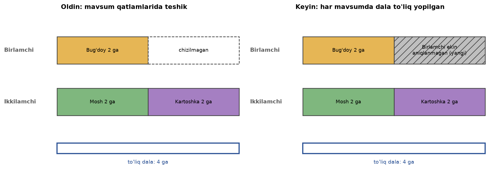
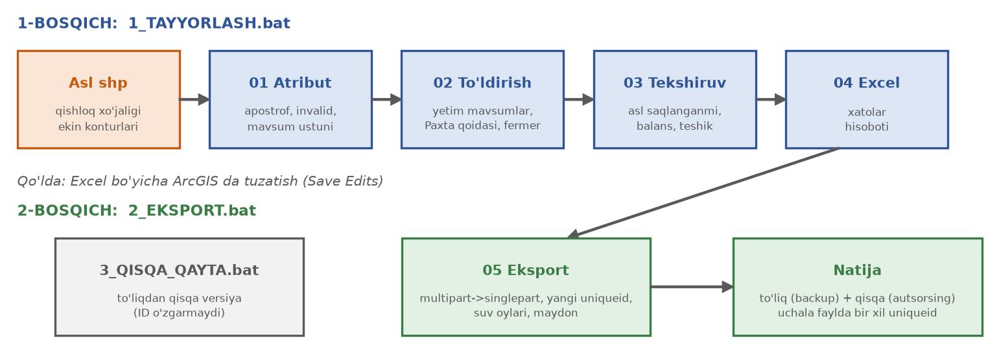
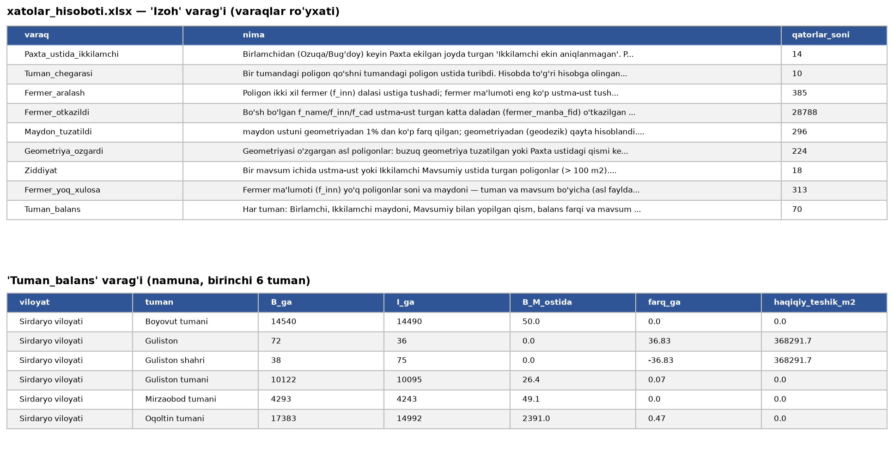

# birlamchi_ikkilamchi

**Ekin yerlari: mavsum (Birlamchi / Ikkilamchi / Mavsumiy) va to'liq dala** — qishloq xo'jaligi loyihasidan
kelgan ekin konturlarini suv iste'molini hisoblash uchun tayyorlaydigan GIS dastur (Python, GeoPandas).

## Versiyalar (loyiha bosqichlari)

| Versiya | Repozitoriy | Nima qiladi |
|---|---|---|
| **v1** (shu repozitoriy, teg `v1.0`) | GitHub [`fazogird/birlamchi_ikkilamchi`](https://github.com/fazogird/birlamchi_ikkilamchi) · GitLab `d.nozimov/birlamchi_ikkilamchi_mavsum` | konturlarni **tuzatish**: mavsum, to'liq dala, fermer ma'lumoti, `uniqueid`, qat'iy suv oylari |
| **v2** | GitHub [`fazogird/polygon_holati`](https://github.com/fazogird/polygon_holati) · GitLab `d.nozimov/dalaga_index_run` | v1 natijasiga **Sentinel-2 indeks** (NDVI, EVI2, NDMI) yozish va dalaning **o'z faol davrini** ajratish → NDVI bo'yicha suv oylari |

v1 natijasi (`ekin_yerlar_toliq.gpkg`, `uniqueid` bilan) v2 ning kirish fayli. v2 da qat'iy oylar (3–5 / 6–10 / 3–10)
har kontur uchun sun'iy yo'ldoshdan aniqlangan haqiqiy faol davr bilan tekshiriladi (masalan, bug'doy 2–6).

## Muammo

Qishloq xo'jaligi loyihasi faqat **ekilgan qismni** chizadi va mavsumlar shevada, chalkash yozilgan.
Natijada bir dalaning bahorgi qatlamida teshik qoladi, kuzgi qatlami esa dalani to'liq qoplamaydi —
fermer bergan suvning bir qismi "yo'qolib" qoladi.



Dastur har bir to'liq dalani **har mavsumda to'liq yopadi**: kuzgi ekin ostida birlamchi yo'q bo'lsa —
"Birlamchi ekin aniqlanmagan", bahorgi ustida ikkilamchi yo'q bo'lsa — "Ikkilamchi ekin aniqlanmagan" qo'shiladi
(manba poligonning aniq nusxasi yoki aniq ayirmasi, geometriya buzilmaydi).

| `ekin_davri` (asl) | `mavsum` | Suv ichish oylari |
|---|---|---|
| Bahorgi | Birlamchi ekin | 3–5 |
| Kuzgi | Ikkilamchi ekin | 6–10 |
| Mavsumiy | Mavsumiy ekin (Paxta, Bog', Beda, Sholi, Boshqa...) | 3–10 |

## Jarayon



1. **`1_TAYYORLASH.bat`** — asl shp ni tanlaysiz → `ekin_yerlar_yakuniy.gpkg` + `xatolar_hisoboti.xlsx`
   (500 ming poligon uchun ~12–15 daqiqa, tumanlar parallel hisoblanadi).
2. **Qo'lda** — Excel dagi ro'yxatlar bo'yicha ArcGIS da tuzatasiz (ixtiyoriy).
3. **`2_EKSPORT.bat`** — tuzatilgan faylni tanlaysiz → **to'liq** (backup) va **qisqa** (autsorsing) versiya:
   multipart → singlepart, yangi `uniqueid` (uchala faylda bir xil), suv oylari, maydon qayta hisoblangan.
4. **`3_QISQA_QAYTA.bat`** — (kerak bo'lsa) to'liq versiyadan qisqa versiyani qayta yasash, ID o'zgarmaydi.

Batafsil yo'riqnoma: **[QOLLANMA.md](QOLLANMA.md)** · Barcha qoidalar va ustunlar ma'nosi: **[QOIDALAR.md](QOIDALAR.md)**

## Natija

| Fayl | Ichida |
|---|---|
| `ekin_yerlar_yakuniy.gpkg` | `ekin_yerlar` (asl + yangi), `qoshilgan`, `tashlangan` qatlamlari; asl 22 ustun saqlanadi |
| `ekin_yerlar_toliq_*.gpkg` | to'liq backup + `uniqueid`, `suv_boshi`, `suv_oxiri`, `qism_no`, `qism_soni` |
| `ekin_yerlar_qisqa_*.gpkg` | `viloyat, tuman, maydon, turi, yil, uniqueid, season, suv_boshi, suv_oxiri` (Baliqxovuz, Issiqxonasiz) |
| `xatolar_hisoboti.xlsx` | qishloq jamoasi tekshiradigan ro'yxatlar (9 varaq) |

**Excel hisobot namunasi** (shaxsiy ma'lumotsiz varaqlar):



## O'rnatish

Windows + Miniconda, `gis_pro` muhiti:
```
conda create -n gis_pro -c conda-forge python=3.10 geopandas pyogrio shapely pyproj scipy openpyxl
```
Repozitoriyni yuklab oling, `.bat` fayllarni ikki marta bosing. Muhit boshqa joyda bo'lsa, `.bat` dagi `ENV` qatorini o'zgartiring.

Buyruq satridan:
```
python pipeline.py tayyorla --shp asl.shp --papka natija_papka
python pipeline.py eksport  --kirish natija_papka\ekin_yerlar_yakuniy.gpkg
python pipeline.py qisqa    --kirish natija_papka\ekin_yerlar_toliq_<vaqt>.gpkg
```

## Tuzilma

```
pipeline.py                  asosiy dastur (bosqichlarni chaqiradi, jurnal yozadi)
1_TAYYORLASH.bat  2_EKSPORT.bat  3_QISQA_QAYTA.bat
scripts/
  01_atribut_mavsum.py       apostrof, buzuq geometriya, mavsum ustuni
  02_dala_toldirish.py       mavsumlarni to'ldirish, Paxta qoidasi, fermer ma'lumoti, maydon (parallel)
  03_yakuniy_tekshirish.py   asl ma'lumot saqlanganmi, balans, teshik (parallel)
  04_xatolar_excel.py        qishloq jamoasi uchun Excel
  05_uniqueid_eksport.py     singlepart, uniqueid, suv oylari, to'liq/qisqa versiya
  06_qisqa_versiya.py        to'liqdan qisqa versiya (ID o'zgarmaydi)
  01b/02b/02c/01c            alohida tekshiruv va yordamchi skriptlar
docs/                        README rasmlari (docs/rasmlar_yasash.py)
QOLLANMA.md  QOIDALAR.md
```

> Ma'lumotlar (shp, gpkg, Excel natijalar) repozitoriyga **kiritilmaydi** (`.gitignore`) — ular faqat lokal kompyuterda saqlanadi.
